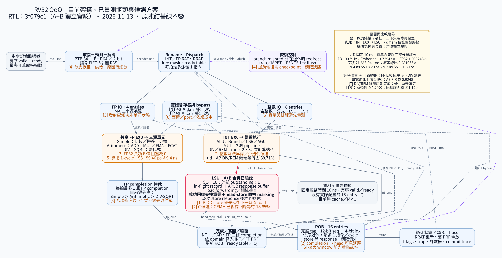

# 目前架構與改善方向

2026-11-13（Asia/Taipei）。下圖是最近完成實體資格的 `3f079c1` **A+B 父版本**：
在同一 LSU 組合成功 registered response 的請求交接與 ROB-head store 同拍 marking。
單寬派發／退休、單一外部資料交易及原凍結基線保持不變。
[完整實驗審查](LSU_AB_REVIEW.md)包含功能、共同流程實體、兩個全 27 項操作點與 PID 波形診斷。

[放大 SVG](../graph/current-ab/bottlenecks.svg) · [PNG](../graph/current-ab/bottlenecks.png) ·
[Graphviz 原始碼](../graph/current-ab/bottlenecks.dot)。
藍色為既有結構，橘色標示待選方向；紅框標示目前最緊的 INT EX0／LSU 輸出路徑。
實線表示主要資料／完成路徑，虛線表示控制／回授。這是模組概覽，省略部分 fan-out、反向 ready 及 CSR 連線。
完成／寫回／喚醒是 core 接線的概念分組；INT、LOAD、FP completion 可並行，FP 三來源共享一條 FP completion。

目前分支已開始[有限 LSU 仲裁實驗](../experiments/lsu-load-arb-v1/README.md)：
首次 head-store marking 可讓安全 load 先送一次，回壓時保持選擇。
圖中時序與效能仍屬父版本；[critical paths](CRITICAL_PATHS.md)亦未宣稱為新 RTL 結果。

## 已確認的結構與操作點

| 結構 | 目前實作 |
| --- | --- |
| 取指／派發／退休 | 各最多一指令／cycle；退休上限 1 IPC |
| 前端 | 指令 FIFO 8、取指追蹤 4、BTB 64、BHT 64×2-bit；無 RAS |
| ROB／完整 tag | 16 entries；12-bit sequence + 4-bit index |
| INT／FP IQ | 8／4 entries；FMA 三來源喚醒 |
| INT／FP PRF | 各 48×32；分別 4R/3W、4R/2W |
| LSU | SQ 16、單一 in-flight、registered response buffer；沒有實際 LQ array、cache、MMU |
| 整數執行 | ALU／Branch／CSR／AGU、3 級 MUL、32 次迭代 DIV／REM |
| FP 執行 | Simple、Arithmetic、DIV/SQRT；算術接受至結果一拍，可連拍接受 |
| FP completion | Simple > Arithmetic > DIV/SQRT |
| 恢復 | branch mispredict 到退休才 redirect；trap／MRET／FENCE.I flush |

A+B 100 MHz 的 Embench／FP32 為 **1.073943×／1.088248×**；面積 **21,663.036900 µm²**，
為原基線 **0.981066×**。兩類效能仍未達 1.20×。最短已測合格 9.4 ns，實際 9.3 ns SS 失敗；
固定 10 ns 記憶體在提頻點需 18.8 ns 才能取樣，因此目前建議以 100 MHz 評估下一輪。

## 編號與下一輪選擇

| 編號／位置 | 已有證據 | 可討論的獨立實驗與限制 |
| --- | --- | --- |
| **① LSU 請求交接／仲裁** | A+B 已完成；相對 A 22 項較快、五項較慢。PID 512 次退休迴圈的波形確認提前 store 壓後下一 load，510 個穩定間隔從 14 變 16 cycles | 優先評估有限、可證明安全的 load／store 選擇；保留 ordering、精確 fault、flush、backpressure 與進展性。未實作新仲裁 |
| **② C：已註冊 load → 頭端前瞻** | A+B GEMM 的 own-response-buffer 等待 18.85%、Cholesky 11.02%、FIR 1.59% | FP32 主線候選；同時傳遞 tag、data、exception，避免 stale tag／重複退休。等待比例不是加速預測 |
| **③ FP 發射／仲裁** | A+B FP32 八項 EX0／完成衝突皆零；先前 A／B 的 minver 有功能單元阻塞觀測 | 保留 minver 的單元感知發射研究；不能用局部機會宣稱全 FP32 改善 |
| **④ 前端／分支恢復** | 單寬前端，無 RAS，退休時 redirect | 先量 miss／return、供給與 resolve-to-retire；提前恢復需精確狀態／checkpoint |
| **⑤ 一拍的時序／面積整理** | A+B 9.4 ns SS 最緊為 INT EX0→dmem 位址 +8.20 ps；FPU 路徑 +59.46 ps | 同時關注 LSU output 與 FPU。新增 FPU pipeline 可能增加相依延遲；純 MHz 改善仍須全工作負載驗證 |
| **⑥ ROB／IQ／PRF** | 容量已核對；A+B FIR 的退休 IPC 0.9248 | 先診斷滿載實際擋住的可執行工作，再決定是否增加面積、ports 或 window |
| **⑦ 整數 DIV／REM** | B observer 完成六組對照與 48 指令控制：一般 33 cycles，無 completion 仲裁等待；A+B ud 的 DIV／REM 頭端等待占 39.71% | 共同選擇提前結果或每拍兩個商位元；B 運算元分布不可改標為 A+B，且 FP32 八項沒有退休整數 DIV／REM |

LSU 仲裁已獲核准並進入驗證，尚未升格基線。多筆 outstanding、實際 LQ、cache、store 回應前退休或雙寬派發／退休
屬更大範圍，需另訂記憶體、精確例外與面積契約。

## RTL 對照與圖的精度

| 圖中結構 | 核對來源 |
| --- | --- |
| 前端、BTB/BHT、解碼 | [frontend](../rtl/frontend/rv32_ooo_frontend.sv) |
| RAT／RRAT／free mask／ready | [rename](../rtl/rename/rv32_ooo_rename.sv) |
| IQ 容量、喚醒與選取 | [INT IQ](../rtl/issue/rv32_ooo_int_iq.sv)、[FP IQ](../rtl/issue/rv32_ooo_fp_iq.sv) |
| 真正 PRF ports | [INT PRF](../rtl/rename/rv32_ooo_int_prf.sv)、[FP PRF](../rtl/rename/rv32_ooo_fp_prf.sv)；部分 package port 常數仍為舊值 |
| EX0、完成、恢復接線 | [core](../rtl/core/rv32_ooo_core.sv) |
| INT 執行／乘除法 | [execute](../rtl/execute/int/rv32_ooo_int_execute.sv)、[multiplier](../rtl/execute/int/rv32_ooo_multiplier.sv)、[divider](../rtl/execute/int/rv32_ooo_divider.sv) |
| FP 三類單元 | [simple](../rtl/execute/fp/rv32_ooo_fp_simple.sv)、[arithmetic](../rtl/execute/fp/rv32_ooo_fp_execute.sv)、[divsqrt](../rtl/execute/fp/rv32_ooo_fp_divsqrt.sv) |
| A+B、SQ、單一資料交易 | [LSU](../rtl/lsu/rv32_ooo_lsu.sv)；`LQ_ENTRIES=16` 只有宣告，沒有配置 LQ array |
| ROB、tag、退休恢復 | [ROB](../rtl/rob/rv32_ooo_rob.sv)、[parameters](../rtl/pkg/rv32_ooo_params.sv) |

FCVT 在目前 core 分派到 Arithmetic，不是 Simple。完整映射 gates 尚未逐一對回 RTL 算式；
圖上的時序位置來自已抽樣 native 路徑，不等於已證明某個演算法是根因。

[先前 B 架構 SVG](../graph/current-b/architecture.svg)、[B Graphviz](../graph/current-b/architecture.dot)、
[B Mermaid](../graph/current-b/architecture.mmd)及[11 月 6 日瓶頸研究](BOTTLENECK_ANALYSIS.md)保留供歷史對照。
