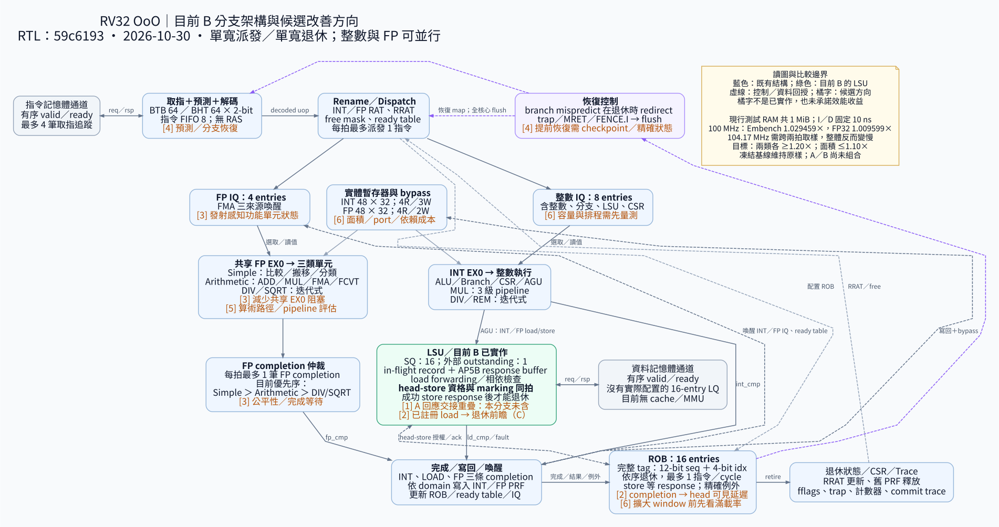

# 目前架構與改善方向

2026-10-30（Asia/Taipei）。圖依 `59c6193c1dee49a6ae03a7aa7657afd31cf1a4e9`
的目前 **B 分支 RTL** 核對；CPU 是單寬派發、單寬退休的 scalar OoO，整數與
浮點執行可以並行。此分支不含 A，原 AP5B v1 凍結基線也未被替換。

[放大 SVG](../graph/current-b/architecture.svg) ·
[PNG](../graph/current-b/architecture.png) ·
[Graphviz 原始檔](../graph/current-b/architecture.dot) ·
[Mermaid 簡化版](../graph/current-b/architecture.mmd)

藍色為已實作結構，綠色強調目前 B 的 LSU；實線表示主要資料／完成路徑，虛線
表示回授／控制。橘色編號標註候選方向，並非已實作或已量得的改善。
圖為模組層級概覽，省略部分 fan-out、反向 ready 線及 CSR 執行期連線；
「完成／寫回／喚醒」框是 core 接線的概念分組，不是新增的單一仲裁器。
INT、LOAD、FP completion 可並行；FP 三個來源則共享一條 FP completion。

## 圖上六個方向

| 編號／位置 | 可以評估的改動 | 目前證據與優先判斷 | 先確認什麼／主要代價 |
| --- | --- | --- | --- |
| **① LSU 請求交接** | A：消耗成功的 response buffer 時，同拍送下一請求；之後另評估 A+B | **最先比較已有證據的方案。** A 在 100 MHz 的 Embench／FP32 為 1.045830×／1.078255×，高於 B 的集合成績；A 尚未使用最新共同 FPU／hold 流程重跑 | 先補同新流程的 A 實體對照；若組合 A+B，需重新驗證 tag 所有權、背壓、flush、fault。不可把兩者收益相加 |
| **② LSU → ROB 頭端** | C：對已註冊 load completion 做 head-ready、結果及例外前瞻 | **有既有等待計數支持的候選，尚未實作。** 原六案例診斷中 FIR 有 8,453 cycles 的頭端 load 回應已暫存等待；該數字是定位，不是可直接消除的週期 | 先核對 B 現況的 head-visible 延遲；資料／access fault 一起傳遞，禁止重複退休或 stale tag；新增 mux 可能拉長 completion-to-retire 路徑 |
| **③ FP 發射／完成仲裁** | 功能單元感知的 issue 選擇，減少共享 EX0 阻塞；另評估完成公平性 | **具體 RTL 假設，效益未量測。** FP IQ 只看來源 ready，已進 EX0 的指令須等其目標單元；完成優先序固定為 Simple → Arithmetic → DIV/SQRT | 量測「EX0 被 busy 單元擋住、另一單元原可執行」及三來源同時完成的次數；兩個假設分開實驗。保留 age／tag、三來源 FMA、flush 與 backpressure |
| **④ Frontend／分支恢復** | 先檢查預測衝突／return misses，再選 BTB/BHT 或 RAS；另案評估執行階段提前 redirect | **結構限制已確認，工作負載收益未量測。** 現有 BTB 64、BHT 64×2-bit、無 RAS；branch mispredict 到退休才恢復 | 先量測 miss rate、return 占比、resolve-to-retire 等待。提前恢復需 RAT／free-list checkpoint 或等價恢復機制，並處理精確例外與已接受的記憶體交易 |
| **⑤ FP 算術資料路徑** | 針對長路徑重構、切 pipeline，或另評估迭代除法／平方根 | **後續候選。** ADD/MUL/FMA/FCVT 經組合運算後進 completion holding register；DIV/SQRT 另有迭代單元。共同映射已修復，沒有加入新 pipeline | 先分清依賴 latency、可接受新操作的間隔、完成仲裁與時序瓶頸。切級可能增加相依鏈 cycles；需重做等價／數值、所有權與三 corner 檢查 |
| **⑥ ROB／IQ／PRF** | 調整 window、queue 容量、選取／喚醒、PRF 或 bypass 結構 | **先做飽和度量測，再決定。** ROB 16、IQ 8/4、PRF 各 48；目前沒有證據證明單純加大一定有效 | 量測 full／free-list-empty／operand-wait／issue-idle。更多 slots／ports 增加面積、比較與 bypass 成本；擴大 window 不會自動解除單寬退休上限 |

「優先判斷」是本次建議，並非已核准的新實作順序。①～⑥的架構變更仍由使用者
參與選擇。多筆 outstanding、實際 LQ、cache 或 store 提前退休屬更大範圍候選，
需另定 request／response、ordering、MMIO、精確 fault 與面積比較條件，未畫成現有硬體。

## 應一起看的量測限制

目前 B 在 100 MHz、固定 10 ns 記憶體下，Embench19 為 **1.029459×**，FP32 八項
為 **1.009599×**。最短已測合格點 9.6 ns（104.17 MHz）反而只有 **0.748705×／
0.719680×**，因固定 10 ns 服務在該時脈需兩拍、19.2 ns 才能取樣。
因此 ⑤不能只看 MHz；每個候選都要以完整集合的 `cycles × 合格 period` 評估。

目前 B 面積為同新流程 baseline 的 **0.989062×**；原基線比為 **0.965070×**，
後者包含流程修復。A 舊流程的面積／時脈不能直接當成新流程的物理對照。
兩類各 ≥1.20×、面積 ≤1.10× 的規劃目標維持不變。PID 在 B 同頻下時間增加
13.9763%，也需留在下一次方案討論，不能只看集合平均。

## RTL 對照與圖的精度

| 圖中結構 | 核對來源 |
| --- | --- |
| 8-entry instruction FIFO、4 筆取指追蹤、BTB/BHT、解碼 | [frontend](../rtl/frontend/rv32_ooo_frontend.sv) |
| RAT／RRAT／free mask／ready、退休後釋放 | [rename](../rtl/rename/rv32_ooo_rename.sv) |
| IQ 容量與來源喚醒、FP issue 選取 | [INT IQ](../rtl/issue/rv32_ooo_int_iq.sv)、[FP IQ](../rtl/issue/rv32_ooo_fp_iq.sv) |
| 真正的 PRF port 數 | [INT PRF](../rtl/rename/rv32_ooo_int_prf.sv)、[FP PRF](../rtl/rename/rv32_ooo_fp_prf.sv)；部分 package port 常數是舊值，不能據此畫圖 |
| 兩路 EX0、FP 單元分流與完成優先序、恢復接線 | [core](../rtl/core/rv32_ooo_core.sv) |
| ALU／branch／CSR／AGU、3 級 MUL、迭代 DIV | [integer execute](../rtl/execute/int/rv32_ooo_int_execute.sv)、[multiplier](../rtl/execute/int/rv32_ooo_multiplier.sv)、[divider](../rtl/execute/int/rv32_ooo_divider.sv) |
| Simple、Arithmetic、DIV/SQRT 分工 | [FP simple](../rtl/execute/fp/rv32_ooo_fp_simple.sv)、[FP arithmetic](../rtl/execute/fp/rv32_ooo_fp_execute.sv)、[FP divsqrt](../rtl/execute/fp/rv32_ooo_fp_divsqrt.sv) |
| SQ 16、單一交易／response buffer、B 同拍 marking／請求 | [LSU](../rtl/lsu/rv32_ooo_lsu.sv)；`LQ_ENTRIES=16` 只有宣告，沒有配置對應 LQ |
| ROB 16、完整 tag、退休、branch redirect 時點 | [ROB](../rtl/rob/rv32_ooo_rob.sv)、[parameters](../rtl/pkg/rv32_ooo_params.sv) |

FP 的整數／浮點轉換 `FCVT` 在目前 core 被分派到 Arithmetic，不是 Simple。
圖中的 3 級 MUL 描述單元內部 pipeline，不代表從 dispatch 到 retire 恆為三拍。
沒有圖示 cache、MMU、RAS 或第二筆資料交易，因為目前並未實作。

參考：[完整架構規格](../architecture_spec.md)、[B 完整驗證](LSU_B_COMPLETE_VALIDATION.md)、
[A 驗證審查](LSU_A_VERIFICATION_REVIEW.md)、[原 LSU 診斷與 A/B/C 定義](LSU_OPTIMIZATION_REVIEW.md)。
本次只新增圖與說明、修正舊狀態敘述，沒有修改 CPU RTL 或重跑 benchmark。
