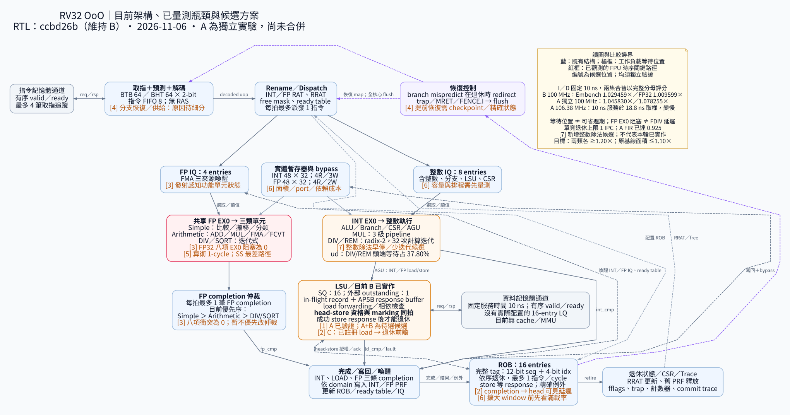

# 目前瓶頸與候選方案

2026-11-13 更新：目前分支為 **A+B 獨立實驗**，完整結果與下一輪選項見
[A+B 審查](LSU_AB_REVIEW.md)及[最新架構圖](../graph/current-ab/bottlenecks.svg)。
100 MHz Embench／FP32 為 1.073943×／1.088248×；最短已測合格 9.4 ns，
面積為原基線 0.981066×。PID 已由波形定位 store／load 仲裁互動；目前最緊
SS 路徑轉為 INT EX0 → 資料記憶體位址，FPU 緊接其後。

以下保留 **11 月 6 日 B 參考版本的分析**及當時提案；A+B 與 divider 唯讀診斷
之後已獲核准並完成，不能再把下方「待選 A+B」當成最新狀態。

2026-11-06（UTC）。當時工作分支 RTL 為 **B**，核對基準 `ccbd26b`；A 保留為獨立實驗，沒有合併 A+B 或替換原凍結基線。本頁以已驗證的全 27 項資料重新分析，沒有新跑 benchmark 或改動 CPU。

**建議先以 100 MHz 降低等待週期。下一個最值得共同選擇的 RTL 實驗是 A+B；一般嵌入式另有整數 DIV／REM 候選。③先限縮為 `minver` 的排程研究，⑤先定位為時序／面積研究。現有資料不支持把 FP 完成仲裁或新增 FPU pipeline 當成全集合效能改善的首選。**

## 架構與目前邊界

[放大 SVG](../graph/current-b/bottlenecks.svg) · [PNG](../graph/current-b/bottlenecks.png) · [Graphviz 原始碼](../graph/current-b/bottlenecks.dot)

核心是單寬取指／派發／退休的 scalar OoO：ROB 16、INT／FP IQ 8／4、INT／FP PRF 各 48×32、SQ 16。整數與 FP 執行可重疊；資料記憶體最多一筆外部 outstanding，沒有實際 16-entry LQ、cache 或 MMU。B 已把 head-store 資格判定與 marking／送出候選同拍化。分支錯誤預測仍到退休才 redirect；原圖①～⑥維持編號，⑦是本次新增的整數除法候選。

| 已資格確認結果（效能比相對原凍結基線） | A | B |
| --- | ---: | ---: |
| 100 MHz：Embench19 | 1.045830× | 1.029459× |
| 100 MHz：平衡 FP32 八項 | 1.078255× | 1.009599× |
| 同流程標準元件面積／baseline | 1.002643× | 0.989062× |
| 最短已測合格時脈 | 9.4 ns | 9.6 ns |

A／B 原基線面積比為 0.978322×／0.965070×，皆符合 ≤1.10×。兩類效能仍未達 ≥1.20×。若以 A 的 100 MHz 結果為比較起點，兩集合還需要額外約 **14.74%／11.29% 相對加速**，等價於集合時間約再降 **12.85%／10.15%**；不是要求每個單項皆改善同一比例。

## 已確認的瓶頸與證據強度

### 1. 記憶體與 LSU／退休交接：最有跨集合證據

固定 I／D 記憶體服務皆為 10 ns。在目前同步取樣模型中，對齊 CPU edge 的服務完成取樣約為 `ceil(10 ns / CPU period) × CPU period`。A 從 10 ns 改成 9.4 ns，audit 的服務可見時間從 10 ns 變成 18.8 ns；完整 Embench／FP32 分數降至 **0.765250×／0.737524×**。這是目前已測操作點的系統瓶頸，不能只用 MHz 乘上原 cycle 結果，也不能為了提頻把記憶體改成固定一拍。

在共同 100 MHz 下，B 的 FP32 等待位置如下。所有百分比皆以各工作負載 ROI cycles 為分母；互斥 bucket 表示「當時 ROB 頭端等在哪裡」，**不是已證明的根因比例，也不是可直接刪掉的 cycles**。

| B 工作負載 | load 頭端等待（INT＋FP） | store ack 等待 | 其他關鍵觀測 |
| --- | ---: | ---: | --- |
| fir | 13.49% | 0.73% | FP EX0／完成衝突均為 0 |
| fft | 18.79% | 11.59% | B 在此項快於 A |
| gemm | 19.59% | 16.73% | A 仍有明顯已暫存 load 等待 |
| bicg | 21.42% | 7.07% | store 減少後，load 等待成為較大的分類 |
| cholesky | 22.89% | 6.10% | 另有 FDIV 頭端等待 10.97% |

A 的 100 MHz 集合比 B 快約 **1.59%／6.80%**，但單項為 A 快 18 項、B 快 9 項；IIR／FFT 是 B 較快。B 的 PID 比原基線慢 13.98%，其 FMA 頭端等待增至 1,023 cycles；不能因 store ack 減少就宣稱總體變快，仍須追相依鏈與排程互動。

② C 的機會也必須用選定父版本重新看：

| 頭端 load 自己的回應已在 buffer 中 | B | A |
| --- | ---: | ---: |
| FIR | 8,735 cycles／11.76% | **517 cycles／0.78%** |
| GEMM | 16,401 cycles／12.25% | **15,603 cycles／12.67%** |

因此不能再拿舊 baseline 的 FIR 8,453 cycles，當成 A 上 C 的收益依據。GEMM 是較值得追蹤的剩餘交接位置。B 的 `mark_pending` 計數採握手前取樣；即使同拍允許送出，該 cycle 仍可落在此分類，不能僅由名稱判斷 B 沒有生效或還能再刪一拍。

### 2. 整數 DIV／REM：新增的嵌入式候選

本次把 81 份既有 profile 的 `integer_other` 逐 PC 以 RV32M opcode 解碼。每一案的拆分總和都與原互斥頭端等待 bucket 相同，無額外假設把其他等待歸入除法。

| 工作負載 | B：DIV／REM 頭端等待 cycles | 占 B ROI | A 中同類等待占比 |
| --- | ---: | ---: | ---: |
| ud | 1,030,166 | 37.80% | 36.55% |
| wikisort | 310,868 | 14.79% | 14.47% |
| st | 672,328 | 9.50% | 9.30% |
| cubic | 737,130 | 5.26% | 5.17% |
| nbody | 263,258 | 4.52% | 4.52% |
| nettle-aes | 105,830 | 2.05% | 2.13% |

例如 `ud` 的 PC `0x80001310`、指令 `0x03564633` 是 signed DIV；該 PC 退休 1,478 次、頭端等待 51,730 cycles。RTL 的一般 DIV／REM 是 radix-2 restoring、固定 **32 次計算迭代**，目前除零及 signed overflow 有特殊快路徑。32 是計算迭代數，不是 dispatch→retire 延遲；表中等待還可能包含來源未 ready、排程及完成仲裁。

相較之下，B 的 `matmult-int` 整數頭端等待約 19.18%，主要 PC 是乘法後的相依 ADD（`0x80000c28`，717,600 head-wait cycles），不能解讀為 ALU 加法本身太慢。這一類需補 dependency／wake-up／completion 事件，而不是直接擴大 ALU。

### 3. FP 排程：局部存在，全 FP32 集合目前沒有直接機會

先前已驗證的 observer 在 baseline／A／B 的 FP32 八項皆量到 **EX0 阻塞 0、completion 衝突 0**。`minver` 的確有 DIV 忙碌擋住另一個 ready 算術操作：B 為 9,990 cycles、A 為 22,200 cycles，分別占 ROI 1.185%／2.585%。這是重疊／可能包含推測執行的機會計數，不是加速上限或可省週期。

FDIV 延遲是另一個問題：B 的 `minver`／`cholesky` FDIV 頭端等待約 24.09%／10.97%，即使沒有 EX0 阻塞，仍可能有相依除法延遲。③發射選擇不會自動縮短已在計算中的 FDIV。對已測八項，單純修改 FP 完成公平性沒有直接收益證據。

### 4. FPU 是目前 B 的時序關鍵路徑；系統效能仍須另外證明

既有 native 100 MHz、SS 路徑的算術 FPU setup 餘裕 **454.05 ps**，下一組 LSU→資料記憶體輸出為 **689.83 ps**，只差約 235.78 ps。這是 global-route 寄生估算下的已抽樣路徑，沒有把匿名 mapped gates 完整反查成特定 RTL 算式，不能斷言某個 leading-zero 或 sticky 運算就是根因。

算術單元已觀測到 **accepted issue→first valid 為 1 cycle，且能連拍發射**。多切一級未必增加吞吐，卻會增加相依延遲、flush／tag 狀態及面積。在 100 MHz 已合格且記憶體政策固定時，只縮短組合路徑通常不會減少 benchmark cycles；其價值先是時序餘裕、面積／映射改善，或為之後真正有效的操作點作準備。

### 5. 單寬、前端與 window：有結構限制，仍須分清機制

A 的 FIR 為 66,117 cycles、61,138 筆 ROI 退休指令（含 closing marker），**IPC 0.9247**。保持同一指令數、100 MHz、單寬退休，即使所有等待都消失，也只剩約 **1.0814× 相對 A 的理想空間**。不能期待單靠加快 FPU 就在此項取得大幅改善。

對全部凍結工作量，零等待／每拍一筆的理想集合上界相對原 baseline 為 Embench **1.7872×**、FP32 **1.4602×**。這是不可當成預測的寬鬆理想界；目前資料沒有證明必須改成雙發射才能達 1.20×，也沒有保證單寬一定能達標。

B 的 `nsichneu` 同時有 load 頭端等待約 35.59% 和 ROB empty 17.35%。ROB empty 不等於 I-cache miss 或分支 mispredict；`rob_full` 也可能是長延遲頭端的後果。④須先量測預測失敗／return miss、resolve→retire 時間與取指供給；⑥須量測滿載時到底擋住多少可執行工作。不能只看到 queue 常滿就擴大 ROB／IQ／PRF。

## 建議方案與實驗次序

| 方案 | 具體範圍與用途 | 主要成本／驗證重點 | 建議定位 |
| --- | --- | --- | --- |
| **① A+B** | 讓 response-buffer 消耗／下一請求重疊，配合 B 的 head-store 同拍 marking；保留一筆外部 outstanding、既有 store ack／精確 fault | 同拍舊回應交付／新請求身份、load/store 優先序、flush、backpressure、tag wrap；收益可能互相遮蔽，面積／時序須重測 | **第一個建議共同核准的 RTL 實驗**；以 baseline／A／B／A+B 比較相互作用 |
| **⑦ 整數除法器** | 先量 req→valid、operand-ready、arbiter 等待與運算元分布；再獨立比較 `abs(a)<abs(b)`、`abs(b)=1`／`abs(b)=2^k`、前導零縮短迭代，或每拍 2-bit 的方案 | signed 截向零、remainder 符號、除零／overflow、flush、backpressure、連續請求；較多每拍運算可能拉長時序 | **一般嵌入式的獨立候選**，目前六項有直接 head-wait 證據；沒有 FP32 八項的直接收益證據 |
| **② C：registered load→head 前瞻** | 僅由現有已註冊 completion 提前提供 ROB 頭端 data／ready／exception；依父版本重查剩餘等待 | 精確 tag、data／fault 同步、避免重複退休；新增 completion→retire mux 可能成關鍵路徑 | A+B 之後或獨立 A+C；先看 GEMM 等剩餘等待，不能沿用舊 FIR 數字 |
| **③ 功能單元感知 FP 發射** | 選擇下一拍可接收的單元；EX0 本拍送出 DIV 時，也要計入下一拍 busy | age／tag、連續 DIV、busy→ready、flush、長期進展；仍需全 27 項驗證 | `minver` 的小範圍排程實驗；降低作為 FP32 主線的優先級 |
| **⑤ 維持 1-cycle 的 FPU 邏輯** | 先將 critical mapped path 對回 RTL，再逐一比較平衡前導位元樹、shift/sticky 分段或安全縮位寬；既有 barrel shift 不當作新功能 | 完整 implementation equivalence、數值／flags、映射、三 corner；純時序改善不等於 cycles 改善 | 保留為時序／面積研究；新增 pipeline 暫不優先 |
| **④／⑥ 前端、預測、容量** | 根據取指／分支／window 因果觀測，選 RAS／預測、較早 redirect 或容量候選 | 提前 redirect 需精確恢復／checkpoint；容量增加影響 mux、PRF 與面積 | 先診斷，再決定是否值得較大架構改動 |

多筆 outstanding／真正 LQ、cache、store 回應前退休或雙寬派發／退休，屬更大範圍變更。它們需要新的記憶體 ordering／MMIO／fault 或前端／PRF／ROB 契約，目前不應混入上述小實驗。

選定後每個候選只改一個設計假設，在獨立分支固定父版本；先功能／定向／Spike／數值及新不變條件，再跑完整 19＋8，最後以同流程合格實體時脈的 `cycles × period` 和標準元件面積驗收。保留逐項退步及總集合結果。不能把 A／B／C 或等待計數直接相加；不更動凍結 ELF、fast 編譯條件、10 ns 記憶體或兩類各 ≥1.20×／面積 ≤1.10× 目標。

## 本次分析的來源與可重現性

[分析摘要與逐項 CSV](evidence/2026-11-06/bottleneck-analysis/README.md)保存 81 份 profile 的來源 SHA、原始分類、逐 PC 整數拆分、IPC 及理想退休上界。新程式重用既有 profile validator，核對 accepted A／B review、固定 baseline、ELF、日誌、model SHA、cycle partition 和 trace/layout mismatch。三版本分數重新計算後完全符合已採認的集合結果。

[原 1／3／5 研究](OPTIMIZATION_135_STUDY.md)供 FP observer 與 native timing 證據；[A 完成封存](evidence/2026-11-05/optimization-135-A/README.md)與 [B 完成封存](evidence/2026-10-29/lsu-b-complete-validation/README.md)供原始工作負載／實體資料。新資料是既有量測的後處理，不是新的候選性能驗證。
