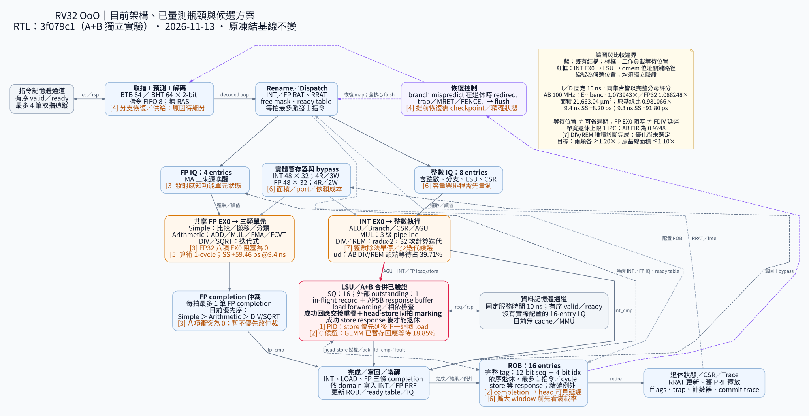

# A+B 合併實驗與下一輪選擇

更新：2026-11-13（Asia/Taipei）。**A+B 的獨立實驗已完成功能、共同流程實體與兩個完整操作點審查。**
保留原凍結基線；兩類效能尚未達各自 1.20×，面積符合 ≤1.10×。

## 結果與操作點

固定原始 ELF、Embench 19 項、FP32 八項；FP32 的 DSP、矩陣／ML 子群各占 50%。
I response、I initiation interval、D response 一律固定 10 ns。

| 候選 | 100 MHz Embench | 100 MHz FP32 | 面積／原基線 | 最短已測合格週期 |
| --- | ---: | ---: | ---: | ---: |
| A | 1.045830× | 1.078255× | 0.978322× | 9.4 ns |
| B | 1.029459× | 1.009599× | 0.965070× | 9.6 ns |
| **A+B** | **1.073943×** | **1.088248×** | **0.981066×** | **9.4 ns** |

| A+B 操作點 | Embench 時間加速比 | FP32 時間加速比 | 功能／數值 | 記憶體實際取樣時間 |
| --- | ---: | ---: | --- | ---: |
| 10 ns／100 MHz | 1.073943× | 1.088248× | 27/27、3,629 數值 | 10 ns |
| 9.4 ns／106.38 MHz | 0.775970× | 0.740353× | 27/27、3,629 數值 | 18.8 ns |

兩點使用 `cycles × period` 計算。更快時脈下的固定 10 ns 記憶體需要跨兩拍取樣，
因此建議繼續以 **100 MHz** 評估下一輪架構；這只是在已測兩點中的選擇，不宣稱搜尋過所有操作點。
100 MHz 的集合時間還需再降約 **10.50%／9.31%** 才能達各自 1.20×，不能只改善其中一類。

A+B 相對 A 的集合增益為 Embench 2.69%、FP32 0.93%；27 項中 22 項較快、五項較慢。
相對 B 則 27 項均較快。這是實際合併結果，沒有將 A、B 增益相乘。

| 相對 A 的退步項目 | A cycles | A+B cycles | 執行時間增加 |
| --- | ---: | ---: | ---: |
| PID | 7,242 | 8,256 | **14.0017%** |
| GEMM | 123,175 | 123,490 | 0.2557% |
| aha-mont64 | 5,354,540 | 5,356,643 | 0.0393% |
| nsichneu | 6,913,377 | 6,917,065 | 0.0533% |
| qrduino | 4,377,993 | 4,411,503 | 0.7654% |

## 實體資格與目前架構

[放大 SVG](../graph/current-ab/bottlenecks.svg) · [PNG](../graph/current-ab/bottlenecks.png) ·
[Graphviz 原始碼](../graph/current-ab/bottlenecks.dot)。只有 LSU 組合 A 的成功回應交接與 B 的頭部 store marking；
仍為單寬派發／退休、ROB 16、INT／FP IQ 8／4、PRF 各 48、SQ 16、單一外部資料交易。

ASAP7、TT 建置、hold40、統一 ready guard、共用已證明的 FPU；獨立 TT／SS／FF 採實際
100 ps 網格試驗。全域繞線 overflow、antenna net／pin violation 皆為零。

- 標準元件面積 **21,663.036900 µm²**：原基線比 **0.981066×**，同流程 baseline 比 **1.005456×**。
- 9.4 ns：SS setup **+8.201440 ps**；最小 hold 在 FF，為 **+17.579993 ps**。
- 相鄰更快的 9.3 ns：SS setup **−91.798569 ps**，實測失敗。
- 最緊已抽樣路徑是 `int_ex0_req_q[65] → dmem_req_addr[2]`，屬 INT EX0／LSU 輸出路徑；
  FPU reg-to-reg 路徑為 **+59.46 ps**。不能沿用 B 的「FPU 一定最差」判斷，也未把匿名 mapped gates
  全部反查成某個 RTL 算式。

這是 global-route 寄生估算的研究資格，沒有新增詳細繞線或 tape-out 宣稱。

## PID：已定位的記憶體仲裁互動

使用原 A、A+B 模型與同一 ELF 補錄 VCD。開啟波形後，完整程式數值輸出、memory audit 和
cycle profile 均與各自原量測相同；逐拍重建的互斥分類與逐 PC 退休／等待計數也完全相符。

在重複的迴圈中，A 先接受下一次迴圈的 load，再送出目前 store；A+B 的提前 store 資格讓
既有 store 優先規則先佔用唯一資料埠，下一個不同位址且其餘條件均可發送的 load 等兩拍後才被接受。
共核對每版 511 個「頭部 store 與可用 load 同時出現」的情境；沒有以 queue 名稱推測原因。

| 510 個穩定迴圈間隔 | A | A+B |
| --- | ---: | ---: |
| 下一 load 相對目前 store 的接受時間 | 早 2 cycles | 晚 2 cycles |
| 迴圈 store 退休間隔 | 14 cycles | 16 cycles |
| 已退休迴圈中 2,048 次算術操作：heavy 接受至 completion | 均為 1 cycle | 均為 1 cycle |

整體差額精確為 `510 × 2 − 1 − 2 − 3 = 1,014 cycles`：穩定間隔增加 1,020，起始／第一個轉換／
尾端合計少六拍。推測或區間外、未對應到退休的請求另列，未混入 512 次已退休迴圈的比較。

互斥 profile 的同一差額為 store ack −1,026、FMA 頭部 +1,020、FADD 頭部 +510、FP store 頭部 +510。
這次已有波形佐證請求順序與依賴鏈的互動；尚未實作新仲裁策略，也沒有宣稱某種修法能直接收回全部差額。
完整 ROI 的選定原始訊號與重算程式已封存；完整程式 VCD 保留在本機，擷取腳本可重現。

## 驗證與來源

- 基線、A、B、A+B 各 83 項 pin-driven 測試，合計 332 項通過；三個負向對照通過。
- 新增 21 個同拍交接情境，包含 INT/FP、年輕 load 競爭、回壓、序號環繞、fault、flush、recovery、完整 tag。
  原 B assertion 與 A 交接行為的衝突由測試抓到後修正，失敗來源與記錄保留。
- 乾淨來源的 normal/assert 模型，18 directed、18 Spike、48 介面、58 記憶體、3,400 有限值 FMA 全部通過。
- 兩個完整 27 項操作點各核對 3,629 數值、記憶體規則與逐 PC 退休工作量。
  100 MHz 沿用已完成的乾淨量測並重查來源；9.4 ns 是本次新跑的完整量測。
- 共用 FPU 的既有 reset／完整轉移／輸出等價證明重新核對實際 module body、ABI、graph 與 lowering；
  連結時 A+B 核心本體未變。這不等於完整 ISA／IEEE-754 覆蓋。

| 階段 | 來源提交 |
| --- | --- |
| CPU、功能資格與 100 MHz 量測 | `3f079c1` |
| 原生綜合 | `52675e2` |
| GRT／hold40／ready guard | `f66e12b` |
| 9.4 ns 完整量測 | `f1d58d3` |
| 總審查與封存工具 | `1f9acf4` |

結果直接寫入主機並逐階段製作可校驗 checkpoint；重啟後重查與原實體審查完全相同。
暫時移出的三個工具映像已恢復原 image ID 並通過 smoke，八個歷史暫存檔及完整 checkout 已還原。
環境腳本的 Docker 程序列表格式錯誤另保留失敗記錄，未計入 CPU 或實體測試。
首次總審查也保留為失敗：PID 重算的整數 histogram 鍵與已保存 JSON 的文字鍵直接比較，
使相同資料被拒絕。改以相同 JSON 表示逐值比較後重跑；原資料正向通過，修改計數或總週期的兩個負向對照仍被拒絕，
沒有略過波形重算或放寬數值比較。

原始記錄與獨立審查見[完整 A+B 證據](evidence/2026-11-13/lsu-ab-complete/README.md)，
先前功能／DIV 診斷見[功能封存](evidence/2026-11-09/lsu-ab-functional/README.md)。

## 建議共同選擇的下一輪

| 方向 | 目前證據 | 下一個可控實驗 |
| --- | --- | --- |
| **LSU 的 load／store 選擇** | PID 已觀測提前 store 使下一迴圈 load 延後；GEMM／qrduino 也有 store 等待下降、load 等待上升 | 優先討論在保持 ordering、fault、flush 與進展性的前提下，是否給可安全發出的 load 有限優先機會；不要直接取消 store 保護 |
| **C：registered load → ROB 頭端前瞻** | A+B 的 GEMM 有 23,281 cycles／18.85%、Cholesky 有 19,993／11.02% 落在自己的回應已暫存等待；FIR 僅 1,054／1.59% | 作獨立 FP32 主線候選；tag、data、exception 同步及避免重複退休，並留意新關鍵路徑 |
| **整數 DIV／REM** | B 的唯讀診斷六組 observer 對照與 48 指令控制通過；一般延遲 33 cycles，沒有完成仲裁等待；A+B 的 ud 同類頭端等待占 39.71% | 在低成本提前結果與每拍兩個商位元間共同選擇；operand 分布屬 B，不能改標為 A+B 實測 |
| **維持一拍的時序／面積整理** | A+B 的 LSU output 已比 FPU 路徑更緊；FP32 EX0／完成衝突仍為零 | 純時序研究同時看 LSU 與 FPU；目前不優先新增 FPU pipeline |

C 的等待比例、DIV 的運算元比例與仲裁改善不能相加當成加速預測。固定 ELF／10 ns 記憶體／兩類
各 1.20× 目標維持；選定父版本及單一假設後，再建立獨立實驗。沒有自動升格 A+B 或實作 C／divider。
