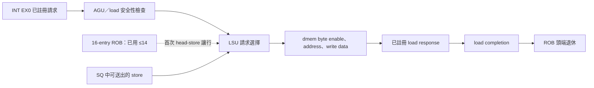

# ROB 空間限制仲裁的實體結果

候選通過 ASAP7 global-route 的三個 corner。在 100 ps 試驗網格上，最短合格週期是 **9.8 ns**（102.04 MHz）。A+B 父版為 9.4 ns。

| Corner | 9.8 ns setup | 9.8 ns hold | 10 ns setup | 10 ns hold |
| --- | ---: | ---: | ---: | ---: |
| TT | +2,950.70 ps | +39.49 ps | +3,150.70 ps | +39.49 ps |
| SS | +57.09 ps | +71.30 ps | +257.09 ps | +71.30 ps |
| FF | +4,547.99 ps | +16.16 ps | +4,747.99 ps | +16.16 ps |

相鄰的 9.7 ns 實測在 SS 的 setup slack 為 **-42.91 ps**。標準元件面積為 **21,498.75 µm²**，相對原基線為 **0.973626×**，相對 A+B 為 **0.992416×**。

## 資料埠與退休路徑

實線標出資料傳遞，虛線標出 ROB 空間允許首次讓行的控制。圖中資料埠只容許一筆外部交易。下表數字來自實體 STA 的映射暫存器與輸出埠。

## Critical paths

以下是 9.8 ns 各 path group 抽樣中最緊的一條。每組含五條實際路徑，表中 slack 已與獨立時序報告對帳。

| Corner／檢查 | 路徑類型 | 起點 → 終點 | Slack |
| --- | --- | --- | ---: |
| SS setup | reg2out | `int_ex0_req_q[64]` → `dmem_req_byte_en[1]` | +57.09 ps |
| SS setup | reg2reg | `fp_ex0_req_q[94]` → `u_fp_execute/cmp_data[107]` | +439.78 ps |
| SS setup | in2out | `dmem_rsp_valid` → `dmem_req_wdata[2]` | +4,574.66 ps |
| SS setup | in2reg | `dmem_rsp_valid` → `u_rob.entries[13][64]` | +4,982.71 ps |
| FF hold | reg2reg | `fp_ex0_req_q[284]` → `u_fp_simple.cmp_data[138]` | +16.16 ps |
| FF hold | in2reg | `imem_rsp_rdata[26]` → `u_frontend.iq_mem[5][101]` | +19.67 ps |
| FF hold | reg2out | `u_rob.commit_trace[246]` → `commit_trace[246]` | +314.07 ps |
| FF hold | in2out | `rst` → `dmem_req_valid` | +375.59 ps |

在 SS 9.8 ns，最緊 byte-enable 路徑的資料到達時間是 8,592.91 ps。9,800 ps 扣除 50 ps 的 setup 不確定度及 1,100 ps 的輸出預算，要求到達時間為 8,650 ps，得到 +57.09 ps 餘裕。

在 100 MHz 的 SS 報告中，全核心最小 setup 為 **+257.09 ps**。另將起點限制為五個 `rob_count` 暫存器、終點限制為 32 個 `dmem_req_addr` 位元，最緊為 **+6385.70 ps**。兩次查詢使用同一份 global-route 資料庫與 10 ns 約束。

## 固定 10 ns 記憶體的完整工作負載

| CPU 週期 | Embench 19／原基線 | 平衡 FP32 八項／原基線 |
| --- | ---: | ---: |
| 10 ns | 1.076286× | 1.109010× |
| 9.8 ns | 0.743052× | 0.711138× |

兩個工作點都跑完 27 項，逐 PC 退休工作量相符，各核對 3,629 個數值。當 CPU 週期從 10 ns 縮至 9.8 ns，固定 10 ns 的記憶體回應從一拍變為兩拍取樣（19.6 ns）。以完整工作負載時間比較，100 MHz 是這兩個實測點中較快的選擇。面積達成 ≤1.10×，Embench 和 FP32 仍各低於 1.20×。

實體資料庫來自乾淨來源 `b3212a8`，共用 FPU、TT 建置、40 ps hold 修復及 ready guard 使用既定流程。三份階段 checkpoint 均通過校驗，最終資料庫的 global-route overflow 及 antenna net／pin 違規均為零。工具環境首次建立曾耗盡磁碟，另一次前驅 FF 收集缺少結束紀錄。保留原始輸出後，從已保存資料庫重跑完整三角審查。

[完整功能比較](LSU_ROB_ROOM_REVIEW.md) · [原始資料與校驗](evidence/2026-11-23/lsu-rob-room-complete/README.md)。
